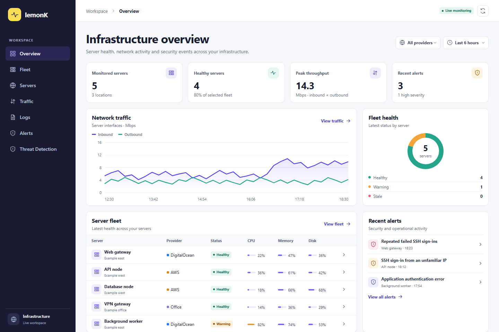

# lemonK Server Monitor

lemonK is a free, self-hosted dashboard for monitoring Linux servers and investigating security activity. It uses Go, React, Docker Compose, OpenTelemetry, VictoriaMetrics, and Loki. Use it with Ubuntu or Debian servers in AWS, DigitalOcean, or your own network.



*Example dashboard using synthetic telemetry.*

## Quick start

Install Docker Engine with the Compose plugin on Linux, or Docker Desktop on Windows or macOS. Then run the following commands.

```bash
git clone https://github.com/lemonkhant/LemonK_severmonitor.git
cd LemonK_severmonitor
docker compose up -d --build
```

Open [http://127.0.0.1:8080](http://127.0.0.1:8080/). The local stack starts with an empty server inventory. For a shared or cloud installation, follow the [Ubuntu deployment and sign-in guide](docs/SETUP.md#deploy-on-ubuntu).

## Monitor a server

1. Open **Servers** and add a Linux host with a unique ID, display name, provider, and address.
2. Open **Setup** on its row. Use **Connect over SSH** on an authenticated deployment, or download the agent YAML for a collector on a private network.
3. Check **Servers** for a recent **Last seen** value. Use **Fleet** for CPU, memory, and disk. Use **Traffic** to see throughput and **Logs** to confirm your chosen log source is reporting.
4. Open **Threat Detection** to inspect findings, edit detection rules, add an IP to the watchlist, or update a case.

[Step-by-step enrollment, log collection, and troubleshooting](docs/SETUP.md)

## Features

| Area | Included |
| --- | --- |
| Server monitoring | CPU, memory, root disk, network throughput, and last-seen status across registered Linux hosts. |
| Log search | Recent application and system logs from Loki, filtered by server and search text. |
| SIEM | Searchable findings from local detections and an optional Wazuh alert source. |
| Threat intelligence | Manual IPv4 and IPv6 watchlist matched against SSH source addresses. |
| Detection Studio | Create, edit, pause, and delete case-insensitive log rules with event thresholds and severity. |
| Exposure Analytics | Inventory address classification and observed log coverage. Open ports and vulnerabilities require separate data sources. |
| SOAR | Automatic review cases for recent high-severity findings, with notes and status history. |
| UEBA | Flags SSH logins from a new source IP after three observed successful logins for the same server and user in the selected window. |

Security findings depend on the logs you collect. Ship SSH authentication logs to use the built-in SSH detections and use the **Logs** view to confirm coverage. The current detector evaluates up to 200 recent Loki events and 200 Wazuh alerts per query.

## License and costs

lemonK source code is available under the [MIT License](LICENSE). Your cloud provider may charge for compute, storage, and network usage. Dependencies and container images have their own license terms.

[Architecture](docs/ARCHITECTURE.md)
