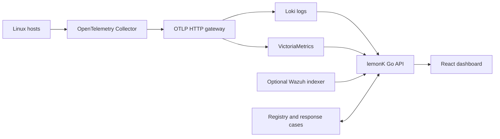

# Architecture

The Go application serves the React bundle and same-origin APIs. The registry and threat configuration live in the dashboard data volume. The gateway routes metrics to VictoriaMetrics and logs to Loki. The browser polls the API for snapshots and security reports.

| Directory | Responsibility |
| --- | --- |
| `cmd/sentinel` | Process configuration, authentication, and server startup. |
| `internal/httpapi` | HTTP handlers, JSON validation, and dashboard routes. |
| `internal/source` | Queries for telemetry and optional Wazuh alerts. |
| `internal/threat` | Detection rules, indicators, behavior heuristics, and case storage. |
| `internal/sshcollector` | SSH-managed collector lifecycle. |
| `web/src` | Dashboard views, charts, forms, and navigation. |

The authenticated office profile enables SSH management. The default Compose profile publishes the dashboard and OTLP receiver on host loopback. Run the Go tests and React build with `docker compose build dashboard`.
